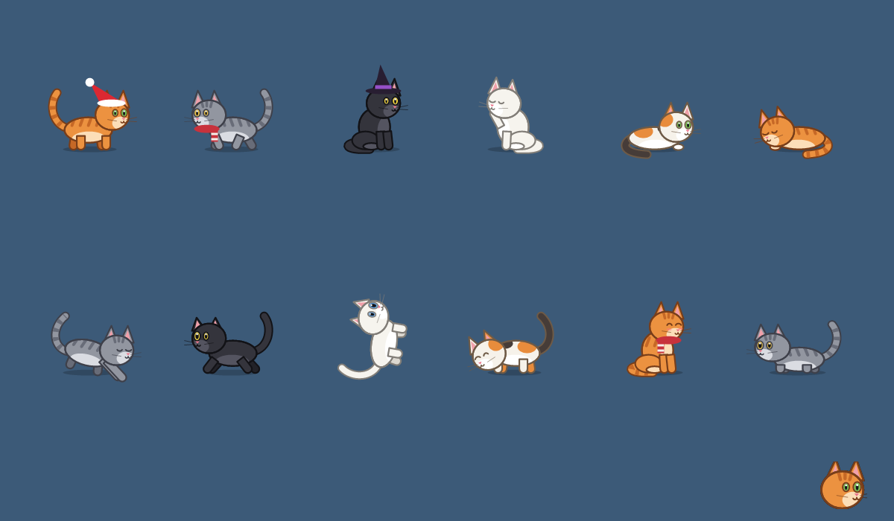
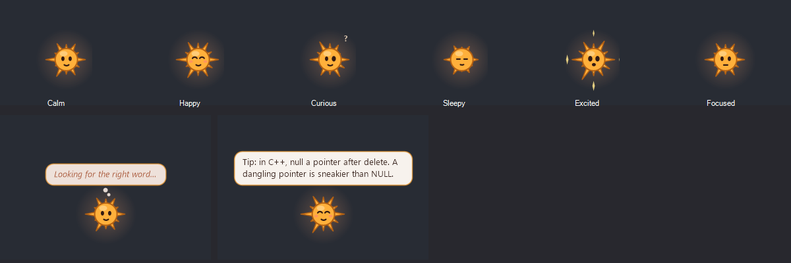

# Kotik

A cartoon cat that lives on your Windows desktop. It walks on top of your windows, naps on the taskbar, climbs the shelves inside programs, chases a laser and sometimes brings you presents. Its little friend Ember, a warm spark, floats nearby, chats with the cat and drops a coding tip now and then.

Everything is drawn in code (GDI+), no images. One small exe, no installer, no internet.

*Русская версия — ниже.*




## What it does

- **Lives on your screen**: walks along the tops of windows, jumps between them, sits on the taskbar, can walk on the "shelves" inside programs (tab bars, toolbars).
- **Click** the cat to pet it. **Drag and release** to throw it. It lands on its feet.
- **Tray menu**: feed it a fish, call it to the cursor, play with the laser, let Ember give it a ride, send both to rest for a while.
- **Ember**: thinks before it speaks, gives coding tips (C++, Python), tells cat facts, chats with the cat, bounces like a ball in quiet spots, helps the cat reach high windows.
- **Music**: when Spotify plays, Ember dances and the cat sways its tail.
- **Seasons and holidays**: falling leaves in November, snow in winter (the cat dives into the piles), a Halloween pumpkin, a snowman that grows through December, a New Year tree with fortunes, fireworks at midnight. Each event can be switched off.
- **Gentle reminders**: a break after a long session, late-night bedtime hints, low battery, low memory.
- **Two languages**: Russian and English, following the Windows language; change it in the settings.
- **Light on resources**: 60 fps, 30 when the computer is busy, and nothing at all while resting. When free memory is low, it switches off the decorations by itself.

Optional features, **off by default**:
- **Code hints**: Ember looks at the C, C++ and Python files you save in recent VS Code projects and points at classic beginner mistakes (`<=` past the end of an array, `=` in a condition, `new` without `delete`, a mutable default argument…). Only rules, no AI, nothing is sent anywhere.
- **Naughty cat**: when you wiggle the cursor around idly, the cat catches it and carries it off to hide. This moves your cursor.

## Install

1. Download `Kotik.exe` from Releases (or build it, see below).
2. Run it. On the first start it asks for the cat's name and your name, and whether to start with Windows.

Needs Windows 10 or 11 with .NET Framework 4.x, which ships with Windows.

**Uninstall**: Quit from the tray menu, delete `Kotik.exe`, and if you want to clear the settings, delete the registry key `HKEY_CURRENT_USER\Software\Kotik` and the `Kotik` value in `HKEY_CURRENT_USER\Software\Microsoft\Windows\CurrentVersion\Run`.

Your own purr: put `purr.wav` next to `Kotik.exe` and the cat will use it.

## Privacy

Kotik works fully offline. To behave like a cat on *your* screen, it looks at:
- window positions and titles, and the name of the active program (to walk on windows and comment on what you open);
- a picture of the active window every few seconds, analysed in memory to find shelves (never saved);
- the Spotify window title and the system sound level (to dance to the music);
- with code hints switched on: VS Code's list of recent folders and the source files in them.

Only the settings and a few small lists are kept, in the registry (`HKEY_CURRENT_USER\Software\Kotik`): phrases already said, your New Year wish, dismissed hints and ignored files. Nothing leaves your computer.

## Build

Uses the C# compiler that comes with Windows; nothing to install except Git Bash. Python with numpy and Pillow is needed only once, to generate the icon and the sounds.

```bash
bash tools/build.sh        # → build/Kotik.exe
```

Developer flags: `--sheet out.png` (every pose), `--buddyshot out.png [en]` (Ember in every mood), `--selftest log.txt`, `--lasertest log.txt`, `--weathertest snow|leaves out.png`, `--lint file.cpp out.txt`.

| File | What's inside |
|---|---|
| `Program.cs` | start, settings, the language switch, the first-run dialog |
| `PetForm.cs` | the cat's window, the tray menu, reminders, holidays, glue |
| `Brain.cs` | how the cat moves: walking, jumping, climbing, hunting |
| `Cat.cs` | drawing the cat, coats and outfits |
| `Buddy.cs` | Ember: drawing, moods, what it says |
| `Talk.cs` | what the cat says |
| `Weather.cs` | leaves, snow, fireworks |
| `Events.cs`, `Season.cs` | the calendar of events |
| `Shelves.cs` | finding shelves inside windows |
| `Lint.cs`, `CodeWatch.cs` | the optional code hints |
| `SettingsForm.cs`, `Wish.cs` | the settings window, the New Year wish |
| `Festive.cs`, `Festive2.cs`, `Toys.cs` | the tree, garland, pumpkin, snowman, snowballs, laser, presents |
| `Native.cs`, `Surface.cs`, `Audio.cs` | Windows calls, transparent drawing, the sound meter |

## License

MIT

---

# Котик

Мультяшный кот, который живёт на рабочем столе Windows. Гуляет по окнам, спит на панели задач, лазает по полочкам внутри программ, гоняется за лазером и иногда приносит подарки. Рядом летает его друг Огонёк — тёплая искорка: болтает с котом и иногда подсказывает что-нибудь про код.

Всё нарисовано кодом (GDI+), картинок нет. Один маленький exe, без установщика и без интернета.

## Что умеет

- **Живёт на экране**: ходит по верхним краям окон, прыгает между ними, сидит на панели задач, гуляет по «полочкам» внутри программ (вкладки, панели).
- **Нажми** на кота — погладишь. **Потяни и отпусти** — подбросишь. Приземляется на лапы.
- **Меню в трее**: покормить рыбкой, позвать к курсору, поиграть лазером, покатать кота на Огоньке, отправить обоих отдохнуть.
- **Огонёк**: думает перед тем, как сказать, даёт советы по C++ и Python, рассказывает факты о котах, болтает с котом, скачет мячиком в тихих местах, подсаживает кота на высокие окна.
- **Музыка**: когда играет Spotify, Огонёк танцует, а кот качает хвостом.
- **Сезоны и праздники**: листопад в ноябре, снег зимой (кот ныряет в кучи), тыква на Хэллоуин, снеговик, который растёт весь декабрь, ёлка с предсказаниями, салют в полночь. Любое событие можно выключить.
- **Мягкие напоминания**: о перерыве после долгой работы, о сне поздно ночью, о севшей батарее и о нехватке памяти.
- **Два языка**: русский и английский, по языку Windows; можно сменить в настройках.
- **Бережёт ресурсы**: 60 кадров в секунду, 30 — если компьютер занят, и ничего, пока отдыхает. Если свободной памяти мало, сам выключает украшения.

По желанию, **по умолчанию выключено**:
- **Подсказки по коду**: Огонёк смотрит файлы C, C++ и Python, которые ты сохраняешь в недавних проектах VS Code, и показывает типичные ошибки новичков. Только правила, без ИИ, ничего никуда не отправляется.
- **Вредина**: если без дела крутить курсором, кот ловит его и уносит прятать. Двигает твой курсор.

## Установка

1. Скачай `Kotik.exe` из Releases (или собери из исходников, см. раздел Build выше).

Нужна Windows 10 или 11 с .NET Framework 4.x (он уже есть в Windows).
2. Запусти. При первом запуске он спросит, как зовут кота и тебя и запускаться ли вместе с Windows.

**Удалить**: «Выход» в меню трея, удалить `Kotik.exe`, а для чистки настроек — ключ реестра `HKEY_CURRENT_USER\Software\Kotik` и значение `Kotik` в `HKEY_CURRENT_USER\Software\Microsoft\Windows\CurrentVersion\Run`.

Своё мурчание: положи `purr.wav` рядом с `Kotik.exe`.

## Приватность

Котик работает полностью без интернета. Он смотрит на положение и заголовки окон, на имя активной программы, на картинку активного окна раз в несколько секунд (только в памяти, чтобы найти полочки), на заголовок окна Spotify и громкость звука (чтобы танцевать под музыку), а с включёнными подсказками — на список недавних папок VS Code и файлы кода в них. В реестре хранятся только настройки и несколько маленьких списков: уже сказанные фразы, новогоднее желание, отклонённые подсказки и игнорируемые файлы. Ничего не уходит с компьютера.
